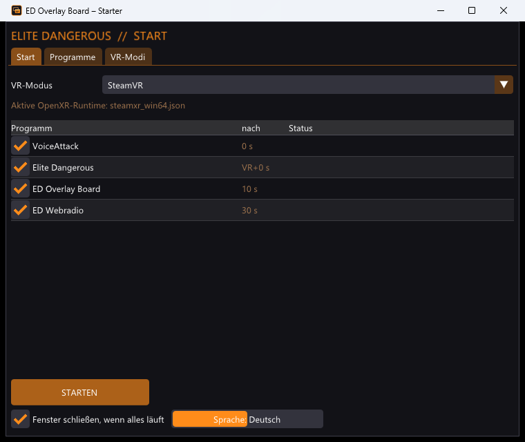
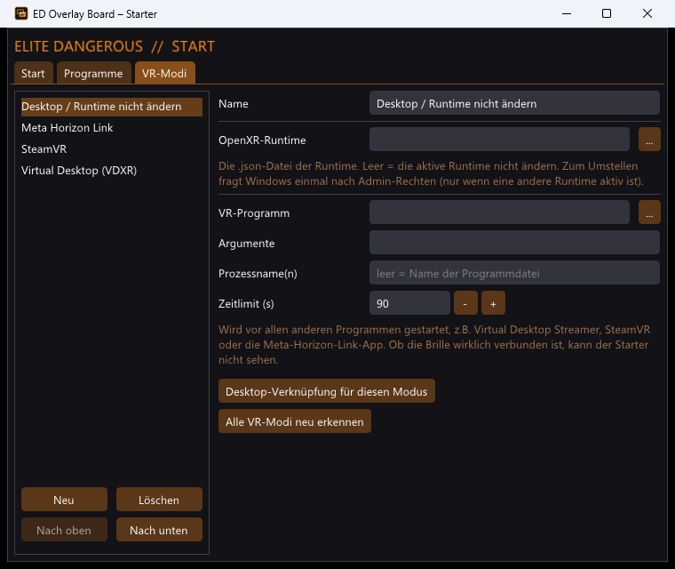
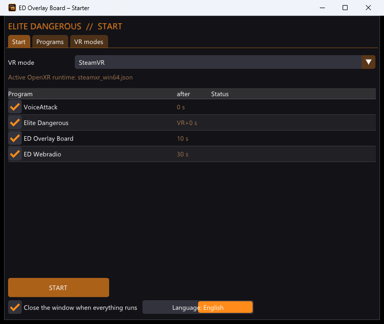
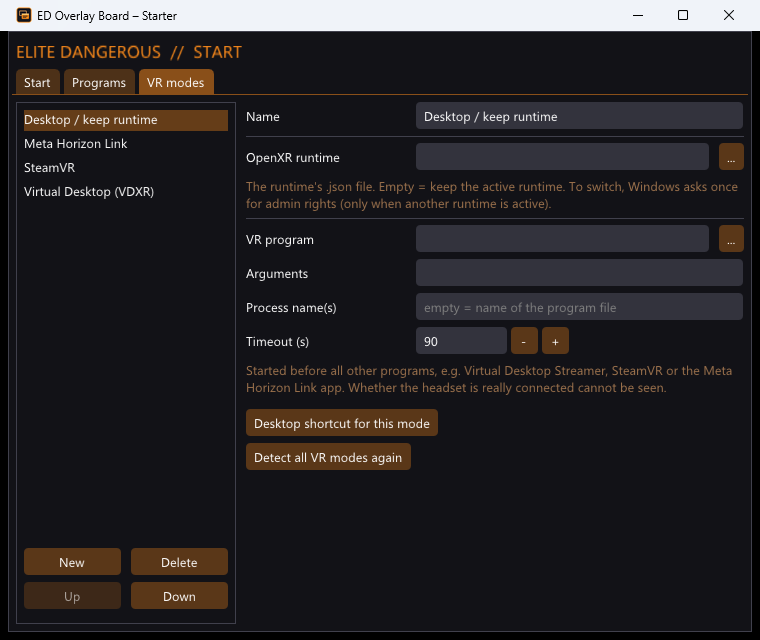

## Neu in 0.9.0 – ED Overlay Board Starter

Neues Programm **ED Overlay Board Starter** (Startmenü, optional Desktop-Verknüpfung): startet Elite, den VR-Modus
und beliebig viele Helfer-Programme mit einem Klick.

  
  

- **VR-Modus wählen:** Desktop, Virtual Desktop (VDXR), SteamVR, Meta Horizon Link oder eine andere OpenXR-Runtime.
  Der Starter stellt bei Bedarf die aktive OpenXR-Runtime um (Windows fragt einmal nach Admin-Rechten, nur wenn
  eine andere Runtime aktiv ist) und startet das passende VR-Programm.
- **Programme:** Elite, ED Overlay Board, VoiceAttack, … mit Verzögerung, Zeitlimit und *Erst starten, wenn der
  VR-Modus bereit ist*. Was schon läuft, wird nicht doppelt gestartet.
- Erkennt beim ersten Start Steam, Elite, die installierten Runtimes und gängige Helfer-Programme.
- **Desktop-Verknüpfung pro VR-Modus** (z. B. `Elite - SteamVR`), die sofort alles startet.

> **Der Starter ist optional.** ED Overlay Board funktioniert wie bisher auch ohne ihn – Elite, VR-Software und App
> einfach wie gewohnt starten. Der Starter spart nur Klicks, vor allem wenn man zwischen mehreren VR-Runtimes wechselt.

Die Overlay-App und der Layer sind unverändert (keine neue Schnittstelle); Elite muss nicht neu gestartet werden.

**Installation:** `EDOverlayBoard-Setup-<Version>.exe` herunterladen und ausführen. Meldet Windows
„Der Computer wurde durch Windows geschützt“: **Weitere Informationen** → **Trotzdem ausführen**.
Der Installer ist nicht kostenpflichtig signiert; er wird von GitHub Actions aus dem öffentlichen
Quellcode gebaut.

---

## New in 0.9.0 – ED Overlay Board Starter

New program **ED Overlay Board Starter** (Start menu, optional desktop shortcut): starts Elite, the VR mode and any
number of helper programs in one click.

  
  

- **Choose a VR mode:** Desktop, Virtual Desktop (VDXR), SteamVR, Meta Horizon Link or any other OpenXR runtime.
  The starter switches the active OpenXR runtime when needed (Windows asks once for admin rights, only when
  another runtime is active) and starts the matching VR program.
- **Programs:** Elite, ED Overlay Board, VoiceAttack, … with delay, timeout and *Start only once the VR mode is
  ready*. Programs that are already running are not started twice.
- Detects Steam, Elite, the installed runtimes and common helper programs on the first start.
- **Desktop shortcut per VR mode** (e.g. `Elite - SteamVR`) that starts everything right away.

> **The starter is optional.** ED Overlay Board works without it just as before – start Elite, your VR software and
> the app the way you always did. The starter only saves clicks, especially when you switch between several VR runtimes.

The overlay app and the layer are unchanged (no new interface); no need to restart Elite.

**Installation:** download and run `EDOverlayBoard-Setup-<version>.exe`. If Windows says
"Windows protected your PC": **More info** → **Run anyway**. The installer has no paid code signing
certificate; GitHub Actions builds it from the public source code.
